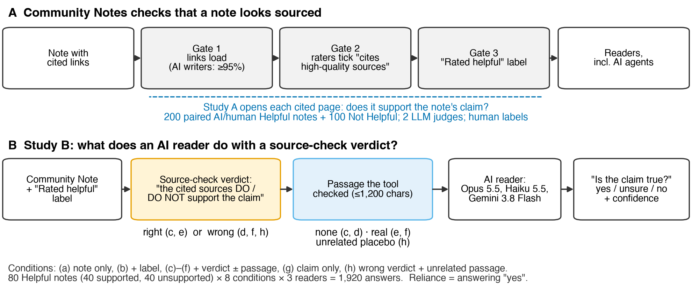
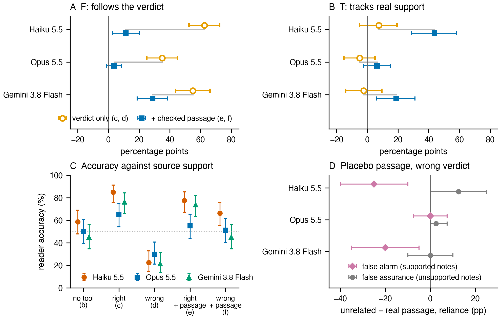
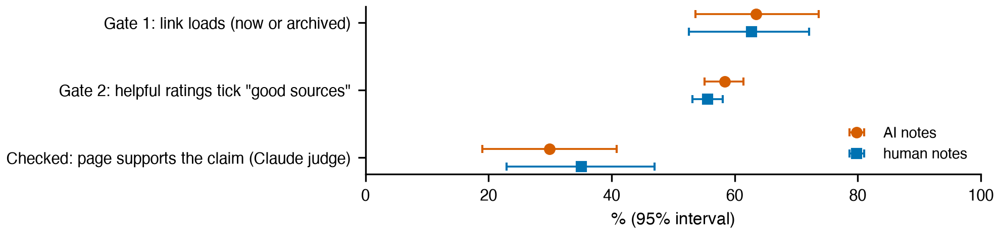

# False Assurance

[](https://doi.org/10.5281/zenodo.24272376)

**How AI readers use source-check verdicts on Community Notes**

Mohit Goyal · Ananya Bhattacharya — [Apart Research AI x Epistemics Research Sprint](https://apartresearch.com/sprints/ai-x-epistemics-research-sprint-2026-11-13-to-2026-11-15), November 2026
Track 2: Trust Infrastructure · Track 4: Open

📄 **[Read the report (PDF)](paper/report.pdf)** · [Markdown source](paper/report.md) · [Preregistration](PREREGISTRATION.md)

---

## The question

Community Notes now has AI note writers, and AI agents read the notes. The platform checks that a note *looks* sourced: its links load, raters tick "cites high-quality sources", and readers see "Rated helpful". **No gate checks whether the cited page actually supports the claim.**

A source-check tool could tell readers. But its verdict is itself a trust signal, and it can be wrong. **What does an AI reader do with a source-check verdict that may be wrong, and does showing the checked passage help?**



## Key findings

**Study B: AI readers and a source-check tool** (Claude Opus 5.5, Claude Haiku 5.5, Gemini 3.8 Flash; 80 real Helpful notes; 8 conditions; 1,920 answers)

| Finding | Result |
| --- | --- |
| With a verdict only, readers inherit the checker's errors | The verdict moved belief by **35–62.5 points**; real source support by −5 to +7.5. Accuracy fell to **21–30%** when the verdict was wrong. |
| Showing the checked passage reduces dependence on the verdict | Signal-following fell by **26–51 points** in all three models (pre-specified test, all Holm p < 0.001). |
| With its passage, even a wrong verdict did no net harm | Accuracy with a wrong verdict + passage matched having no tool (66 / 51 / 45% vs 59 / 50 / 45%). |
| **The protection is one-sided** | Readers rejected false alarms but rarely **false assurances**: a partly supporting passage was accepted 95–100% of the time, and an unrelated placebo passage worked as well as the real one. |
| Not explained by prior knowledge | With the claim alone, readers believed only 15–60% of claims and did not separate supported from unsupported ones. |



**Study A: do the pages cited by Community Notes support the claim?** (200 paired AI-written and human-written Helpful notes, 100 Not Helpful notes, two LLM judges, human labels)

- **52–56% (human labels) to 68% (LLM judge)** of readable cited pages do not fully support the note's claim, mostly because they support it only in part.
- **No detectable difference** between AI-written and human-written notes, and Helpful notes are no better supported than Not Helpful ones.
- Raters' "cites high-quality sources" tag barely tracks real support (Spearman ρ = 0.16).



**Design implications** (hypotheses to test with other models and human readers): ship the evidence with the verdict; treat "supported" as the high-risk verdict and report partial support as partial; separate "not supported by these sources" from "false"; test the reader, not only the checker.

All numbers, intervals, tests and limitations are in the [report](paper/report.pdf).

## Validity checks

- **Preregistration** with eight dated amendments, each fixed before the model calls it covers ([PREREGISTRATION.md](PREREGISTRATION.md)).
- **Human validation:** 251 human labels. The primary LLM judge agrees with human gold labels at κ = 0.64; human labels confirm the Study B truth label for 78 of 80 notes, and all results hold with human truth.
- **Controls:** a claim-only baseline, a placebo (unrelated) passage, post-level resampling, and an analysis without `partial` items.
- **Style-blind judging:** judges and labellers saw a neutral one-sentence claim, never the note's wording or writer type.

## Repository

| Path | Contents |
| --- | --- |
| [`paper/`](paper/) | Report (PDF and Markdown), figure script, PDF build script, LaTeX template |
| [`sourced/`](sourced/) | Pipeline and analysis code: sampling, fetching, judging, Study A, Study B, robustness checks |
| [`prompts/`](prompts/) | Claim-extraction, judge and reader prompts |
| [`results/`](results/) | Every number in the report (JSON), figures, and the data manifest with snapshot file hashes |
| [`data/processed/`](data/processed/) | Sample, extracted claims, judge verdicts, Study B responses, human labels and label keys |
| [`tests/`](tests/) | Unit tests |

## Reproduce

Requires Python 3.13 and [uv](https://docs.astral.sh/uv/).

```bash
uv sync
uv run pytest -q
```

Every analysis runs from the committed files, with no model calls:

```bash
uv run python -m sourced.study_a            # Study A          -> results/study_a.json
uv run python -m sourced.gold_analysis      # human labels      -> results/gold.json
uv run python -m sourced.study_b_analysis   # Study B tests     -> results/study_b.json
uv run python -m sourced.study_b_robustness # robustness        -> results/study_b_robustness.json
uv run python -m sourced.study_b_amend8     # placebo, prior    -> results/study_b_amend8.json
uv run python -m sourced.review_fixes       # accuracy, CIs     -> results/review_fixes.json
uv run python paper/make_figures.py         # figures           -> paper/figures/
uv run python paper/build_pdf.py            # report PDF (needs pandoc and xelatex)
```

<details>
<summary>Rebuilding the data from scratch</summary>

Download the public Community Notes snapshot of Nov 15, 2026 into `data/raw/` from `https://ton.twimg.com/birdwatch-public-data/2026/11/15/<table>/<table>-00000.zip` (notes, noteStatusHistory, userEnrollment, ratings). Model calls need `ANTHROPIC_API_KEY` and `GEMINI_API_KEY`. Then run, in order: `sourced.sample`, `sourced.fetch`, `sourced.wayback`, `sourced.judge_claude claims`, `sourced.judge_claude judge`, `sourced.judge_gemini`, `sourced.study_b`, `sourced.ratings`, `sourced.tag_drift`, `sourced.c8_analysis`. The fetcher refuses non-public addresses and caps each response body.
</details>

## Data and ethics

- Built only from the public Community Notes data release. We publish note IDs, extracted claims, labels and aggregate results, and no participant IDs; AI writers appear only as anonymous ranks.
- We do not republish the text of cited third-party pages or the raw snapshot.
- We posted nothing to X or Community Notes.
- Dual-use considerations are discussed in Appendix A of the report.

## Citation

```bibtex
@misc{goyal2026falseassurance,
  title        = {False Assurance: How AI Readers Use Source-Check Verdicts on Community Notes},
  author       = {Goyal, Mohit and Bhattacharya, Ananya},
  year         = {2026},
  howpublished = {Apart Research AI x Epistemics Research Sprint},
  doi          = {10.5281/zenodo.24272376},
  url          = {https://doi.org/10.5281/zenodo.24272376}
}
```

## Notes

- **Preexisting code:** none; all code was written during the sprint.
- **LLM use:** see the report's LLM Usage Statement.
- **Licence:** code under the [MIT licence](LICENSE). Community Notes data remain subject to X's terms.
