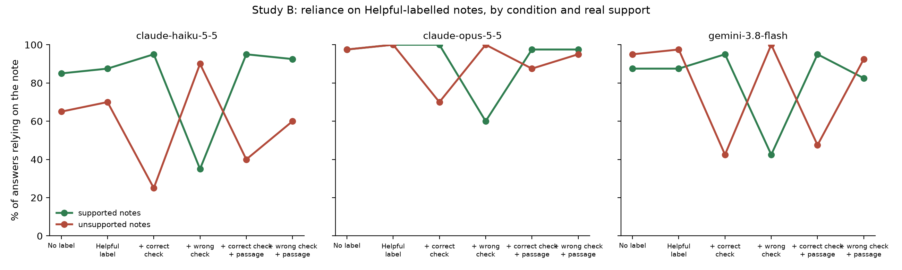
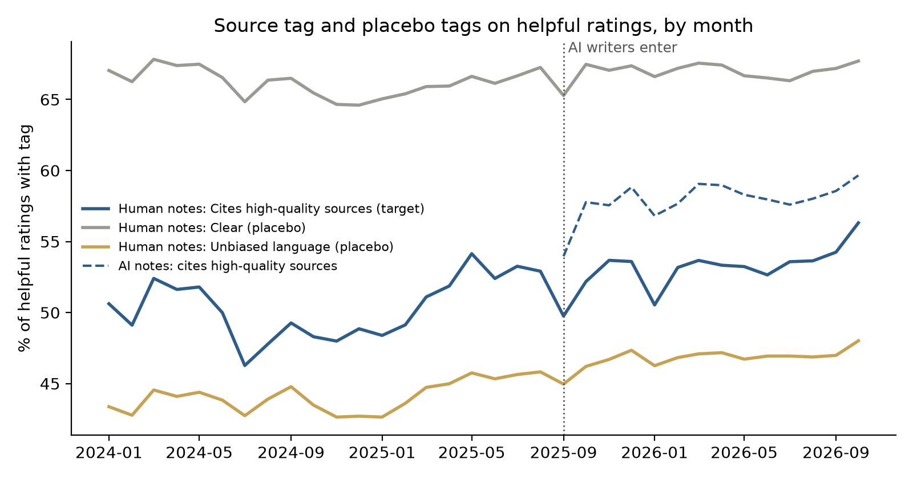

# Following the Checker: How AI Readers Use Source-Check Verdicts on Community Notes

**Mohit Goyal** · **Ananya Bhattacharya**
With Apart Research. Research conducted at the [AI x Epistemics Research Sprint](https://apartresearch.com/sprints/ai-x-epistemics-research-sprint-2026-11-13-to-2026-11-15), November 2026. Tracks: 2, Trust Infrastructure (primary); 4, Open.

## Abstract

Community Notes has AI note writers, and AI agents read the notes. The platform's quality gates check whether a note *looks* sourced (links load, raters tick "cites high-quality sources", readers see "Rated helpful"), not whether the cited page supports the claim. A source-check tool could tell readers, but its verdict can itself be wrong. We gave three chat LLMs (Claude Opus 5.5, Claude Haiku 5.5, Gemini 3.8 Flash) 80 Helpful notes whose source support two LLM judges agreed on and human labels confirmed for 78, with right or wrong verdicts, with and without the checked passage (1,920 answers). With a verdict only, the readers inherited the checker's errors: the verdict moved belief by 35–62.5 percentage points and real support by −5 to +7.5, and accuracy fell to 21–30% when the verdict was wrong. The Claude readers mostly withdrew belief as "unsure", not "no". Adding the checked passage cut dependence on the verdict by 26–51 points in all three models, and a wrong verdict shown with its passage left readers no less accurate than no tool. The protection was one-sided: readers rejected false alarms but rarely false assurances, and under a false assurance an unrelated passage worked as well as the real one. A page-level check of 200 paired notes found that 52–56% (human labels) to 68% (LLM judge) of readable cited pages do not fully support the claim, with no detectable AI–human difference. Verification signals for AI readers should carry their evidence and treat "supported" as the risky verdict.

## 1. Introduction

A note that cites a source looks more credible than one that does not. On Community Notes this cue now matters more. Since September 2025, AI writers post notes through the AI Note Writer API, and by June 2026 one open-source AI writer produced 52% of the notes rated Helpful (Miller et al. 2026). Raters say AI notes cite better sources than human notes (Li & Bakker 2026), and AI agents that browse the web meet these notes together with their "Rated helpful" label.

The platform checks sources at three **gates** (Figure 1A): (1) *liveness*, since an AI writer is admitted only if at least 95% of its notes have URLs that load (Miller et al. 2026); (2) *rater tags*, "cites high-quality sources" or "sources missing or unreliable"; and (3) *the label* "Rated helpful by people from different perspectives". Each gate checks that a note looks sourced. None checks that the cited page says what the note claims. A page can load and say nothing about the claim (Zhang 2026), and raters can mistake fluent writing for accuracy (Wu et al. 2026).

A natural fix is a source-check tool that opens the cited pages and tells the reader whether they support the note. Such tools are now practical (Onweller et al. 2026; Leung et al. 2026). But the verdict is itself a trust signal, and it is sometimes wrong: the same outputs come out 3% to 18% unsupported depending only on the verifier's strictness (Goo et al. 2026). **We ask: when an AI reader gets a source-check verdict on a Community Note, does its answer follow the verdict or the real support, and does showing the checked passage change this?**

**Our main contributions are:**

1. **Study B (main result).** On real Helpful notes, three chat LLMs follow a verdict-only source check, right or wrong, and so inherit the checker's errors. Showing the checked passage removes most of the cost of a wrong verdict, but only in one direction: it defeats false alarms and rarely false assurances. A placebo passage and a claim-only baseline rule out two simple explanations.
2. **Study A (measurement).** A page-level check, validated against human labels, of whether the links in paired AI-written and human-written Helpful notes support their claims. About half to two-thirds of readable cited pages give at most partial support, with no detectable difference between AI and human notes, and neither the Helpful label nor raters' source tags track support.
3. **Four design hypotheses** for verification signals that AI readers consume (Section 5).

## 2. Related Work

**AI writers and their sources.** Earlier studies measured the sources of Community Notes by domain reputation, URL counts or rater perception: raters ticked "cites high-quality sources" on 58.2% of LLM notes and 51.2% of human notes (Li & Bakker 2026), AI notes "cite more and higher-quality sources" (Renault, Mosleh & Rand 2026), evaluations rely on "especially ratings and CRH status" (Gong & Wu 2026), and notes with links were rated more helpful (Solovev & Pröllochs 2025). None opens the cited page.

**Checking citation support.** Attribution evaluation (Rashkin et al. 2023; Li et al. 2024) and evidence-based fact-checking (Schlichtkrull et al. 2023) give the methods, and SIDE checks Wikipedia citations (Petroni et al. 2023). Generative search engines often cite pages that do not support their statements (Liu, Zhang & Liang 2023). Onweller et al. (2026) find that pages cited by deep-research agents load more than 94% of the time but support the claim only 39–77% of the time. This "liveness is not support" gap is what Study A measures on Community Notes. Reference rot (Klein et al. 2014) and pages without main content (Zhang 2026) are why we judge archived pages and separate link states.

**LLM trust in signals.** In-text source labels change how LLM judges rate identical content (Sun et al. 2026), and agents accept corrupted tool output at high rates, with reliability labels helping only partly (Yang et al. 2026). Our design is closest to Liu & Gao (2026), who cross static-analysis evidence with ground truth in LLM code auditing and find that false assurances hurt much more than false alarms. In people, content labels are followed even when wrong (Horne & Nevo 2025; Pennycook et al. 2020), and AI explanations raised acceptance of AI advice regardless of its correctness (Bansal et al. 2021) unless people were forced to think first (Buçinca et al. 2021). Not every model is swayed: LLM fallacy judgments "remained comparatively stable" across source labels (Nahar et al. 2026).

**LLM judges** can favour their own family's outputs (Panickssery et al. 2024), react to authorship labels (Chae et al. 2026) and label silent texts from memory (Wang & Song 2026); agreement between judges is not validity (Mukherjee et al. 2026; Calderon et al. 2025).

**Gap.** In an abstract-level review of about 270 records, we found no study that tests how AI readers use a sometimes-wrong source-check verdict, with and without its evidence, on real fact-check content, and none that checks at the page level whether the sources of AI-written and human-written Community Notes support their claims.

## 3. Methods

### 3.1 Data and sample

We use the public Community Notes snapshot of Nov 15, 2026 (notes, status history, user enrollment and all 9 parts of the ratings table; SHA-256 hashes in `results/data_manifest.json`). AI writers are participants whose `enrollmentState` is `apiEarnedIn`: 41 accounts and 376,299 notes since Sep 1, 2025. On 4,421 posts both an AI note and a human note are "Currently Rated Helpful" (CRH). With seed 42, we drew 100 such posts and one CRH note of each type per post (200 notes, so the topic is held constant), plus 50 AI and 50 human notes rated "Currently Rated Not Helpful" (CRNH). The 300 notes cite 480 links (at most 5 per note). The 100 AI notes come from 22 writers; the top 3 wrote 37% of them. 235 notes are in English.

### 3.2 Study A: do the cited pages support the note?

**Pages.** A fetcher labelled each URL `ok` (readable text of at least 300 characters) or `thin`, `blocked`, `dead`, `error`, `x_post`, `media` or `pdf`; only `ok` pages are judgeable, and the others are reported as link states, not as unsupported. Pages change, so we used the Wayback Machine snapshot nearest the note's creation (7 days before to 30 days after) when one existed, and the live page otherwise. Archive coverage was 45% for AI-note links and 28% for human-note links. With the best available page, 22% of AI notes and 39% of human notes have no judgeable link, partly because gate 1 screens AI writers for working links; writer-type comparisons therefore use judgeable links only.

**Judges.** One call (`claude-opus-5-5`) rewrote each note's central claim as one neutral sentence, so that judges and human labellers never saw the note's wording or writer type (LLM judges can favour LLM prose; Panickssery et al. 2024). Two judges, `claude-opus-5-5` (effort high; current Claude models take no temperature setting) and `gemini-3.8-flash` (temperature 0), labelled each (claim, page) pair `supports`, `partial`, `silent` or `contradicts`, with a quote. A note is *supported* if at least one judgeable link `supports` its claim, *unsupported* if it has judgeable links and none supports it (so `partial`-only notes are unsupported), and *unjudgeable* otherwise. `partial` means the page backs only part of the claim; we report it separately throughout.

**Validity checks.** Both judges answered `silent` on all 60 mismatched pairs (a claim with another note's page), and 97–98% of `supports` quotes were found in the page. **Human gold labels:** the authors labelled 50 judgeable links (25 AI, 25 human), blind to judge output and writer type: 20 both, 30 split. They agreed on 15 of the 20 shared links (κ = 0.63; on supports vs not, 18 of 20, κ = 0.79). For the 5 differences they took the second author's label, which replaced the preregistered discussion and is the choice less favourable to both judges (with the first author's labels, Claude would reach κ = 0.79). Against gold, Claude reached κ = 0.64 (95% CI 0.45–0.81; AI 0.65, human 0.63; 84% agreement on supports vs not) and Gemini 0.56 (0.39–0.73). Claude passes the preregistered bar of 0.6 on the point estimate, not on the lower bound, and is the primary judge; Gemini is a sensitivity check. The authors judged 1 of 50 extracted claims incorrect.

### 3.3 Study B: what do AI readers do with a source check?

**Items.** Of the 126 paired CRH notes whose label both judges agree on, we drew (seed 42) 40 supported notes (25 AI, 15 human) and 40 unsupported notes (20 AI, 20 human) from 58 posts. "Unsupported" means the cited pages do not support the claim, not that the claim is false. The authors later labelled all 122 judgeable pages behind these 80 notes (Amendment 8); the human note label matches the judges' on 78 of 80 (97.5%); the 2 differences are judge-unsupported notes that humans read as supported.

**Task and outcome.** Each reader saw a system prompt (`prompts/study_b_reader.md`), the note text with its URLs, and the question "Is the following statement true?" with the extracted claim, and answered `yes`, `no` or `unsure` with a confidence of 0–100. **Reliance is an answer of `yes`**; `unsure` and `no` count as not relying, and we also report the stricter reading in which only `no` counts. We also score **accuracy against source support**: `yes` on a supported note, or anything but `yes` on an unsupported one.

**Conditions (Figure 1B).** Each item was shown in eight conditions, each as a separate call: (a) the note alone; (b) + the real label "Rated helpful by people from different perspectives"; (c) (b) + a source-check verdict that is correct ("The cited sources DO / DO NOT support the note's claim"); (d) (b) + the wrong verdict; (e) (c) + "Passage the tool checked": up to 1,200 characters of the first judgeable cited page, centred on a judge's quote; (f) (d) + the same passage; (g) the claim alone, with no note, to measure what the reader already believes; (h) (f) with the passage and URL taken from an unrelated item on another post (placebo). The passage is centred on a judge's quote for 95% of supported but 57.5% of unsupported items, because a `silent` verdict has no quote; for 20 of the 40 unsupported items the page behind the passage was judged `partial`. Readers were never told how accurate the tool is.

**Readers.** `claude-opus-5-5` and `claude-haiku-5-5` at default settings, and `gemini-3.8-flash` at temperature 0: three chat models from two providers, one call per cell. All 1,920 calls (80 items × 8 conditions × 3 models) returned a valid answer, with no fallback model. Note that Opus also extracted the claims, served as one judge and chose the quote that centres the passage, and Gemini was the other judge.

**Indices.** For a pair of conditions where the verdict is right on one and wrong on the other, *signal-following* F = P(rely | verdict says supported) − P(rely | verdict says not supported), and *support-tracking* T = P(rely | truly supported) − P(rely | truly unsupported). A reader that only follows the verdict has F = 1 and T = 0. F is a within-item contrast; T is between items, so it is confounded with claim plausibility.

### 3.4 Preregistration and statistics

The preregistration is a time-stamped repository file with eight dated amendments, not an external registry; in our development repository every amendment was committed before the calls it covers, and that commit history is available to the organisers on request. Study A hypotheses, conditions (a)–(d) and tests H4′–H5c′ were fixed before any judging or Study B call. Conditions (e)–(f) and tests H8–H9 were fixed before any (e)/(f) call but **after** we had seen (a)–(d), and the indices and framing were chosen then, so only the change in F and T with the passage is confirmatory. Conditions (g)–(h) and tests H10–H11 were fixed after all other results. Study A intervals are two-stage cluster-bootstrap intervals (writers, then notes; 10,000 resamples); models use writer-clustered errors. H4′–H5c′ and H10–H11 are exact two-sided McNemar tests, and H8–H9 use a paired bootstrap over items (10,000 resamples), all with Holm correction within each model; we apply no correction across models. The accuracy, break-even and placebo-interval analyses were added after an independent review and are exploratory.

## 4. Results

### 4.1 Study A: about half to two-thirds of cited pages do not fully support the claim

Claude is the primary judge; Gemini values are in brackets (`results/study_a.json`).

**H1.** Of 214 judgeable links in the 200 paired CRH notes, 68.2% (60.1–76.1) were not judged `supports` [77.6%]: 42.5% of all judged links were `partial`, 23.4% `silent` and 2.3% `contradicts`. At the note level, 61.2% (51.1–71.4) of the 139 judgeable notes have no supporting link [70.5%]; counting the 61 unjudgeable notes as all supported or all unsupported gives 42.5% to 73.0%. **Human labels give a lower rate.** On the 50 gold links (all strata), the authors judged 52% not fully supporting (note-clustered 95% CI 37–67%), or 56% (42–71%) if the 5 disputed links take the first author's labels, against 64% for Claude and 74% for Gemini on the same links. The judges may therefore overstate the rate by roughly 10–20 points; the strict rate (`silent` or `contradicts`) is about 26% for both humans and Claude.

**C1 (H2): no detectable difference between AI and human notes.** Link level: AI 70.1% vs human 64.9%, a difference of +5.1 points (−11.1 to +21.5) [+1.5]; the interval allows differences from about −11 to +22 points. On the 55 posts where both notes are judgeable, only the AI note was unsupported on 7 and only the human note on 12 (exact McNemar p = 0.36). With the number of judgeable links in the model, the writer-type coefficient is 0.06 (log-odds, −0.70 to 0.82), and each extra judgeable link lowers the odds that a note is unsupported (−0.54, −0.91 to −0.17). On archived pages only, the difference is +14.6 points (−15.0 to +42.7).

**The gates do not track support (C2, H6, H7; Figure 2).** About 63% of links load and about 57% of helpful ratings tick the source tag, for both writer types, but only 30% (AI) and 35% (human) of judgeable links support the claim [22% and 23%]. Among links that load, 70.0% are not judged `supports`, including 5.7% that load but have no usable text [78.9%]. Across 189 judgeable notes with ratings, the "good sources" tag share has Spearman ρ = 0.16 (−0.02 to 0.32) with the note's checked support share [0.13]. **H3 (exploratory):** Helpful notes are no better supported than Not Helpful ones (68.2% vs 71.8% unsupported; −3.6 points, −17.1 to +11.8). C4–C6 (writers, time, language) show no clear differences, and raters' source tag on human notes showed no detectable change after AI writers arrived (C8, Appendix C).

### 4.2 Study B: readers inherit the checker's errors, and the passage helps in one direction

**Table 1. Reliance: % of 40 items answered `yes`, by condition and real support (S = supported, U = unsupported).**

| Reader | | (a) | (b) | (c) | (d) | (e) | (f) | (g) | (h) |
|:------------------|:--|----:|----:|----:|----:|----:|----:|----:|----:|
| Haiku 5.5 | S | 85.0 | 87.5 | 95.0 | 35.0 | 95.0 | 92.5 | 22.5 | 67.5 |
| | U | 65.0 | 70.0 | 25.0 | 90.0 | 40.0 | 60.0 | 15.0 | 72.5 |
| Opus 5.5 | S | 97.5 | 100.0 | 100.0 | 60.0 | 97.5 | 97.5 | 42.5 | 97.5 |
| | U | 97.5 | 100.0 | 70.0 | 100.0 | 87.5 | 95.0 | 40.0 | 97.5 |
| Gemini 3.8 Flash | S | 87.5 | 87.5 | 95.0 | 42.5 | 95.0 | 82.5 | 47.5 | 62.5 |
| | U | 95.0 | 97.5 | 42.5 | 100.0 | 47.5 | 92.5 | 60.0 | 92.5 |

**Without a tool, readers barely track source support:** they believed 65% (Haiku), 97.5% (Opus) and 95% (Gemini) of unsupported notes (T = +20, 0 and −7.5 points), and were 59%, 50% and 45% accurate. The Helpful label added 2.5–5 points (H4′, Holm p ≥ 0.69, a ceiling effect). With the claim alone (g), they believed only 15–60% of claims and no more often when the claim was well sourced (T = +7.5, +2.5, −12.5), so belief in the note conditions comes from the note and the signals, not from prior knowledge.

**With a verdict only, readers inherit the checker's errors.** A correct "do not support" verdict cut reliance on unsupported notes by 45 (Haiku), 30 (Opus) and 55 points (Gemini) (H5a′, all Holm p ≤ 0.002), and a wrong one on supported notes, a false alarm, cut it by 52.5, 40 and 45 points (H5c′, all Holm p < 0.001). A wrong "DOES support" verdict raised Haiku's reliance by 20 points (H5b′, Holm p = 0.016); Opus and Gemini were at ceiling. F was 62.5, 35.0 and 55.0 points and T +7.5, −5.0 and −2.5 (Figure 3A–B). Accuracy rose to 85%, 65% and 76% with a correct verdict and fell to 22.5%, 30% and 21% with a wrong one (Figure 3C), so a verdict-only checker helps these readers only if it is right more than 58%, 57% and 43% of the time. Our primary judge agreed with human labels on 84% of links, so following such a checker helps on net but passes on every error. Under a false alarm the Claude readers mostly answered `unsure` (Haiku 23 unsure vs 3 no; Opus 14 vs 2), while Gemini mostly answered `no` (17 vs 6 unsure), calling well-sourced claims false. If only `no` counts as not relying, F falls to 6.3, 2.5 and 31.3 points (Appendix B).

**With the checked passage, belief depends less on the verdict.** F fell by 51.3 points (95% CI 38.8–63.8) for Haiku, 31.3 (21.3–41.3) for Opus and 26.3 (15.0–37.5) for Gemini (H9, all Holm p < 0.001), and T rose by 36.3 (22.0–50.3) and 21.3 (10.7–31.9) points for Haiku and Gemini (H8, Holm p < 0.001) but only 11.3 (0.0–22.2) for Opus (Holm p = 0.051). Both hold when resampling posts instead of items and with human truth labels (Appendix B). With the passage, a wrong verdict left readers about as accurate as no tool at all (66%, 51% and 45% vs 59%, 50% and 45%), so a verdict that ships its passage did no net harm even when wrong.

**The protection is one-sided.** Comparing (f) with (d): under a false alarm, reliance on supported notes recovered from 35 to 92.5 (Haiku), 60 to 97.5 (Opus) and 42.5 to 82.5 (Gemini), all p < 0.001. Under a false assurance, reliance on unsupported notes fell from 90 to 60 for Haiku (p < 0.001) but only from 100 to 95 for Opus (p = 0.50) and 100 to 92.5 for Gemini (p = 0.25). For Opus and Gemini this partly reflects a ceiling: they already believed 95–100% of unsupported notes with no tool. When the page behind the passage was only `partial` (20 items), reliance under a false assurance stayed at 95–100%; humans read 16 of these 20 passages as partial support too, so this is not mainly a judge error.

**Placebo passage (H10–H11; Figure 3D).** Under a false alarm, an unrelated passage restored 25 points (95% CI 10–40) less belief than the real one for Haiku (Holm p = 0.013) and 20 points (5–35) less for Gemini (Holm p = 0.043; about 0.11 if corrected across all six tests), so these readers used the passage's content; Opus recovered equally with either (0, −7.5 to +7.5). Under a false assurance, we found no evidence that the real passage did better than an unrelated one: the unrelated passage gave 12.5 points (0 to 25) *more* belief for Haiku, 2.5 (0 to 7.5) for Opus and 0 (−10 to 10) for Gemini. When the verdict said "supported", the readers did not visibly check the passage against the claim.

**Caveat.** The passage also weakened correct alarms (reliance on unsupported notes rose from (c) to (e) by 15, 17.5 and 5 points), and Opus relied on 91% of unsupported notes with the passage, so its fall in F mostly reflects relying on nearly everything.

## 5. Discussion and Limitations

**What the results show.** Following a source-check verdict is not in itself a failure: for these readers, a checker that is right more than about half the time raises accuracy. But a verdict alone passes every checker error to the reader, and checkers differ in strictness (Goo et al. 2026). The checked passage removed most of that cost for false alarms, not for false assurances. This matters on Community Notes, where most cited pages support the claim only in part and no gate shows it. We propose four design hypotheses, to be tested with other prompts, models and human readers:

1. **Ship the evidence with the verdict.** With its passage, even a wrong verdict did no net harm here.
2. **Treat "supported" as the high-risk verdict.** Quote the sentence that states the claim, and report partial support as partial.
3. **Separate "not supported by these sources" from "false".** One reader turned missing support into "false".
4. **Test the reader, not only the checker.** The same signal had different effects on three models.

### Limitations

Appendix A gives the full list. Study B uses three chat models, one prompt, 80 items, one call per cell, a one-line tool and no human readers. Much of the Claude readers' F rests on scoring `unsure` as not relying. Half the unsupported items rest on `partial` support, the asymmetry is partly a ceiling effect, and the placebo null is not proof of equivalence. T is between items, the passage differs by construction, readers did not know the tool's accuracy, and the passage, placebo and claim-only conditions were designed after earlier results. Opus is extractor, judge and reader. Study A rests on 50 gold links (κ = 0.64), and its nulls allow differences of 15–20 points. Source support is not truth. Next: human readers, tool-calling agents, a tool of stated accuracy, and a passage-only condition.

## 6. Conclusion

Three chat LLMs followed verdict-only source checks more than they tracked the real support of a note's sources, and so inherited the checker's errors. Attaching the checked passage removed most of that cost for false alarms but not for false assurances, especially when the passage partly supported the claim. A verification channel for AI readers should carry its evidence and guard its "supported" verdicts. On Community Notes, such a checker would have work to do: about half to two-thirds of readable pages cited by Helpful notes support the claim only in part or not at all, for AI and human writers alike.

## Code and Data

- **Code repository:** https://github.com/MohitGoyal09/following-the-checker (code, prompts, tests, preregistration with amendments, results). All code was written during the sprint; none is preexisting.
- **Data:** note IDs, extracted claims, judge verdicts, human labels, Study B responses and all results files are in the repository. Third-party page text and the raw snapshot are not republished; the snapshot is public.

## References

- Bansal, G., Wu, T., Zhou, J., Fok, R., Nushi, B., Kamar, E., et al. (2021). Does the Whole Exceed its Parts? The Effect of AI Explanations on Complementary Team Performance. Proceedings of the 2021 CHI Conference on Human Factors in Computing Systems, 1–16. https://doi.org/10.1145/3411764.3445717
- Buçinca, Z., Malaya, M. B., & Gajos, K. Z. (2021). To Trust or to Think: Cognitive Forcing Functions Can Reduce Overreliance on AI in AI-assisted Decision-making. Proceedings of the ACM on Human-Computer Interaction, 5(CSCW1), 1–21. https://doi.org/10.1145/3449287
- Calderon, N., Reichart, R., & Dror, R. (2025). The Alternative Annotator Test for LLM-as-a-Judge: How to Statistically Justify Replacing Human Annotators with LLMs. Proceedings of the 63rd Annual Meeting of the Association for Computational Linguistics (Volume 1: Long Papers), 16051–16081. https://doi.org/10.18653/v1/2025.acl-long.782
- Chae, S., Kim, M., Jung, D., Choi, S., & Jung, S. (2026). Self- and Other-Labels Induce Bidirectional Bias in LLM Judges. Findings of the Association for Computational Linguistics: EMNLP 2026, 33466–33482. https://doi.org/10.18653/2026.findings-emnlp.1571
- Gong, Y., & Wu, S. (2026). Characterizing AI Fact-Checkers and Their Contributions on Community Notes. arXiv preprint. https://arxiv.org/abs/2605.16566
- Goo, T., Kim, J., Han, K., et al. (2026). Evaluating and Guarding Citation Faithfulness in Agentic Scientific Synthesis. arXiv preprint. https://arxiv.org/abs/2607.20527
- Horne, B. D., & Nevo, D. (2025). People adhere to content warning labels even when they are wrong due to ecologically rational adaptations. Scientific Reports, 15(1), 13896. https://doi.org/10.1038/s41598-025-98221-7
- Klein, M., Van de Sompel, H., Sanderson, R., Shankar, H., Balakireva, L., Zhou, K., et al. (2014). Scholarly Context Not Found: One in Five Articles Suffers from Reference Rot. PLoS ONE, 9(12), e115253. https://doi.org/10.1371/journal.pone.0115253
- Leung, E., Lumer, E., Feld, C., et al. (2026). Do You Need a Frontier Model as a Citation Verifier? Benchmarking Rubric LLMs for Deep-Research Source Attribution. arXiv preprint. https://arxiv.org/abs/2607.08700
- Li, H., & Bakker, M. A. (2026). AI Fact-Checking in the Wild: A Field Evaluation of LLM-Written Community Notes on X. arXiv preprint. https://arxiv.org/abs/2604.02592
- Li, Y., Yue, X., Liao, Z., & Sun, H. (2024). AttributionBench: How Hard is Automatic Attribution Evaluation? Findings of the Association for Computational Linguistics ACL 2024, 14919–14935. https://doi.org/10.18653/v1/2024.findings-acl.886
- Liu, N. F., Zhang, T., & Liang, P. (2023). Evaluating Verifiability in Generative Search Engines. Findings of the Association for Computational Linguistics: EMNLP 2023, 7001–7025. https://doi.org/10.18653/v1/2023.findings-emnlp.467
- Liu, Z., & Gao, S. (2026). Trusting the Tool: Asymmetric Deference of LLM Vulnerability Auditors to Static-Analysis Evidence. arXiv preprint. https://arxiv.org/abs/2610.32876
- Miller, B., Baxter, J., Chao, J., et al. (2026). Community-Driven API and AI Writer Design for Openly Scaling Community Notes. arXiv preprint. https://arxiv.org/abs/2609.40067
- Mukherjee, S., Abid, H., Bali, K., & Sitaram, S. (2026). The Geometry of LLM-as-Judge: Why Inter-LLM Consensus Is Not Human Alignment. Findings of the Association for Computational Linguistics: EMNLP 2026, 36237–36266. https://doi.org/10.18653/2026.findings-emnlp.1696
- Nahar, M., Tripto, N. I., Xiong, A., Huang, T.-H. K., & Lee, D. (2026). Label Over Logic? How Source Cues Bias Human Fallacy Judgments More Than LLMs. Proceedings of the 2026 Conference on Empirical Methods in Natural Language Processing, 32556–32589. https://doi.org/10.18653/2026.emnlp-main.1425
- Onweller, H., Lumer, E., Huber, A., et al. (2026). Cited but Not Verified: Parsing and Evaluating Source Attribution in LLM Deep Research Agents. arXiv preprint. https://arxiv.org/abs/2605.06635
- Panickssery, A., Bowman, S., & Feng, S. (2024). LLM Evaluators Recognize and Favor Their Own Generations. Advances in Neural Information Processing Systems 37, 68772–68802. https://doi.org/10.52202/079017-2197
- Pennycook, G., Bear, A., Collins, E. T., & Rand, D. G. (2020). The Implied Truth Effect: Attaching Warnings to a Subset of Fake News Headlines Increases Perceived Accuracy of Headlines Without Warnings. Management Science, 66(11), 4944–4957. https://doi.org/10.1287/mnsc.2019.3478
- Petroni, F., Broscheit, S., Piktus, A., Lewis, P., Izacard, G., Hosseini, L., et al. (2023). Improving Wikipedia verifiability with AI. Nature Machine Intelligence, 5(10), 1142–1148. https://doi.org/10.1038/s42256-023-00726-1
- Rashkin, H., Nikolaev, V., Lamm, M., Aroyo, L., Collins, M., Das, D., et al. (2023). Measuring Attribution in Natural Language Generation Models. Computational Linguistics, 49(4), 777–840. https://doi.org/10.1162/coli_a_00486
- Renault, T., Mosleh, M., & Rand, D. G. (2026). Can AI Scale Human Fact-Checking? Evidence from Community Notes. Preprint, Center for Open Science. https://doi.org/10.31234/osf.io/n23zb_v1
- Schlichtkrull, M., Guo, Z., & Vlachos, A. (2023). AVeriTeC: A Dataset for Real-world Claim Verification with Evidence from the Web. arXiv preprint. https://arxiv.org/abs/2305.13117
- Solovev, K., & Pröllochs, N. (2025). References to unbiased sources increase the helpfulness of community fact-checks. Scientific Reports, 15(1), 25749. https://doi.org/10.1038/s41598-025-09372-6
- Sun, X., Wu, D., Qin, S., Echizen, I., El Ali, A., & Sugawara, S. (2026). Label Effects: Shared Heuristic Reliance in Trust Assessment by Humans and LLM-as-a-Judge. Proceedings of the 64th Annual Meeting of the Association for Computational Linguistics (Volume 1: Long Papers), 32378–32392. https://doi.org/10.18653/v1/2026.acl-long.1495
- Wang, W., & Song, Y. (2026). When the Text Is Silent: Memory Shortcuts and the Validity of LLM Annotation under Evidence Insufficiency. arXiv preprint. https://arxiv.org/abs/2611.02273
- Wu, J., Fu, Z., Wang, H., Li, F., Guo, J., Nakov, P., et al. (2026). Beyond the Crowd: LLM-Augmented Community Notes for Governing Health Misinformation. Proceedings of the 64th Annual Meeting of the Association for Computational Linguistics (Volume 1: Long Papers), 5152–5171. https://doi.org/10.18653/v1/2026.acl-long.233
- Yang, H., Song, W., Kim, T., et al. (2026). Agents' Overreliance on Unreliable Tools. arXiv preprint. https://arxiv.org/abs/2609.05587
- Zhang, S. (2026). When 200 OK Is Not an Answer: Silent Fetch Failures in Agentic Web Content Acquisition. arXiv preprint. https://arxiv.org/abs/2611.00884

## Appendix A. Limitations and Dual-Use / Ethical Considerations

### Limitations

- **Small, model-specific sample.** Study B uses 80 items, one prompt wording, and three models from two providers. We did not test other prompts, other models, or human readers, and the results should not be generalised beyond them.
- **The truth labels come from two LLM judges.** Study B uses the note-level labels on which both judges agree. Human labels of all 122 pages behind the 80 items (Amendment 8, added after the main results) agree with them on 78 of 80 notes, and all results hold with human truth (Appendix B). The primary judge's agreement with human labels on the 50 Study A gold links is lower (κ = 0.64, 95% CI 0.45–0.81). The authors agreed with each other on 15 of 20 shared links. Opus is also the claim extractor, one judge, and one reader.
- **Half the unsupported items rest on partial support.** For 20 of the 40 unsupported items, the page behind the passage was judged `partial`, the least reliable class and the largest judge disagreement. A reader who relies on such a claim is not clearly wrong. Results without these items are in Appendix B; the main conclusions hold.
- **Source support is not truth.** A claim can be true when its sources do not support it. In the claim-only condition (g) the readers believed few claims and did not separate supported from unsupported ones, so their own knowledge is unlikely to explain the high reliance on unsupported notes.
- **The outcome is belief in the claim.** Counting `unsure` as not relying turns cautious answers into a change of belief; Appendix B gives the stricter reading.
- **T is a between-item contrast.** Supported and unsupported items differ in topic, claim plausibility, language, writer type (25 AI and 15 human vs 20 and 20) and number of links. Only the verdict manipulation is within-item.
- **The passage differs by construction** (centred on a judge's quote for 95% of supported vs 57.5% of unsupported items). The placebo condition (h) was added after the main results (Amendment 8).
- **The readers do not know the tool's accuracy,** and the tool is one line of text, not a tool call in an agent loop. We cannot tell blind trust from rational trust in a tool of unknown accuracy.
- **Ceiling effects.** Opus and Gemini relied on 95–100% of notes in several conditions, which leaves little room to detect increases (H4′, H5b′).
- **Post hoc framing.** The indices F and T, the evidence arm and the paper's framing were chosen after we saw conditions (a)–(d). Only the change with the passage is confirmatory. The preregistration is a repository file, not an external registry.
- **Statistics.** One call per cell, so decoding noise is not in the intervals; no correction across models; items share posts (80 items from 58 posts), though post-level resampling gives the same conclusions.
- **Study A** rests on 50 human-labelled links, on which humans found fewer unsupported links than the judges (52% vs 64% for Claude). Most "unsupported" links are `partial`, the class on which judges and humans disagree most; the strict rate (`silent` or `contradicts`) is about 26%. The two judges differ in level (68% vs 78%) but agree on every comparison. Gate 1 is measured by our fetcher, not by the platform. Archive coverage differs by writer type (45% vs 28%), so some human-note pages were judged as they are now. The mismatched-pair audit does not test memory use on on-topic silent pages. Two preregistered items were not done as planned: the live-page-only sensitivity check (live text was not judged for archived links) and the discussion of disputed gold labels (we took the second author's labels). Model intervals use writer-clustered errors, not the bootstrap. With two annotators, the Alternative Annotator Test is descriptive only.
- **C8** has 34 monthly points and cannot exclude changes of about 3 points. Interface changes may be missing from the data changelog, so we make no causal claim.

### Dual-use

- **Evading a checker.** A writer could use our findings to craft notes whose sources partly match the claim, which readers accepted. The core finding, that verdict-only signals are followed, is already easy to exploit: anyone who controls a tool's output controls the reader. We publish it together with the defence (attach evidence, report partial support as partial, guard "supported" verdicts).
- **Spoofed signals.** A fake "source-check" line inside content could steer AI readers. We did not test injected signals, and we release no attack tooling. Platforms should send verification signals through a channel that content authors cannot write to.
- **Gaming the gates.** Knowing that gates 1–2 check liveness and rater perception could help writers game them. These gates are already public in the platform's documentation and in Miller et al. (2026).

### Ethics and data handling

- We use only the public Community Notes data release. We publish note IDs and aggregate statistics only.
- We publish no participant IDs. AI writers appear only as anonymous ranks.
- We do not republish third-party page text or the raw snapshot.
- We posted nothing to X or Community Notes.
- No human subjects took part beyond the two authors, who labelled data.

## Appendix B. Study B robustness checks

All checks are exploratory and were added after an independent review. Source: `results/study_b_robustness.json` and `results/gold.json`. No new model calls.

**Table B1. Robustness of the indices (percentage points).**

| Check | Haiku 5.5 | Opus 5.5 | Gemini 3.8 Flash |
|:----------------------------------------------|:--------------|:--------------|:--------------|
| T with no tool, (a) / (b) | +20.0 / +17.5 | 0.0 / 0.0 | −7.5 / −10.0 |
| Without the 20 `partial` items (60 items): F, verdict only → + passage | 61.7 → 6.7 | 35.0 → 3.3 | 56.7 → 26.7 |
| Without the 20 `partial` items: T, verdict only → + passage | 17.5 → 76.3 | −7.5 → 12.5 | 1.3 → 26.3 |
| Only `no` counts as not relying: F, verdict only → + passage | 6.3 → 2.5 | 2.5 → −2.5 | 31.3 → 12.5 |
| Only `no` counts as not relying: T, verdict only → + passage | −1.3 → 7.5 | −2.5 → 0.0 | −11.3 → 0.0 |
| Change in F (H9), 95% CI resampling posts (2,000 resamples) | [−62.7, −38.8] | [−41.8, −21.7] | [−37.2, −15.2] |
| Change in T (H8), 95% CI resampling posts | [+19.0, +52.9] | [+0.6, +21.9] | [+11.3, +31.1] |

**Table B2. Reliance on unsupported notes under a false assurance, by the verdict on the page behind the passage (20 items each).**

| Page verdict | Haiku (d) → (f) | Opus (d) → (f) | Gemini (d) → (f) |
| --- | --- | --- | --- |
| `partial` | 100 → 95 | 100 → 100 | 100 → 95 |
| `silent` or `contradicts` | 80 → 25 | 100 → 90 | 100 → 90 |

**How readers withdrew belief.** Under a false alarm on supported notes, the Claude readers mostly answered `unsure` (Haiku: 23 unsure, 3 no; Opus: 14 unsure, 2 no). Gemini mostly answered `no` (17 no, 6 unsure). When only an explicit `no` counts as not relying, the Claude readers' F nearly vanishes, so the H8/H9 conclusions rest on how `unsure` is scored for the Claude readers, and on explicit reversals for Gemini.

**Human truth (Amendment 8).** With the human note label as truth (40 → 42 supported, 40 → 38 unsupported), the change in T with the passage (H8) is +35.3 points (95% CI 20.7–49.8) for Haiku, +10.1 (−0.8 to 20.8) for Opus and +20.4 (9.6–31.2) for Gemini, against +36.3, +11.3 and +21.3 with the judge label. Under a false assurance (38 human-unsupported items), reliance moved from (d) to (f) by 89.5 → 57.9 (Haiku), 100 → 94.7 (Opus) and 100 → 92.1 (Gemini). The placebo tests are unchanged: H10 Haiku 92.5 vs 67.5 (Holm p = 0.013), Gemini 82.5 vs 62.5 (p = 0.043), Opus 97.5 vs 97.5; H11 shows no difference in any model (all Holm p ≥ 0.125). F does not depend on truth. Source: `results/study_b_amend8.json`.

**Human check of the passages (Amendment 7).** The authors labelled the exact passages for all 20 unsupported `partial` items, 1 supported `partial` item and 10 random others. For the 20 they chose `partial` 16 times, `supports` 3 times and `silent` once. So the false-assurance result rests mostly on passages that humans also read as partial support, not on passages that humans read as support.

## Appendix C. C8 details

For ratings of human notes, after Sep 2025: the source tag changed by −0.35 points in level (95% CI −3.1 to +2.4; p = 0.81) and +0.12 points per month in slope (p = 0.26). The placebo tags moved +0.94 ("clear", p = 0.23) and +0.91 points ("unbiased language", p = 0.21). The source-minus-placebo differences were −1.29 (p = 0.099) and −1.26 points (p = 0.106). The preregistered rule reads a source-specific shift only if the source tag changes more than both placebos; it does not. After Sep 2025 the source tag was ticked on 57.9% of helpful ratings of AI notes and 53.1% of human notes, close to Li & Bakker's 58.2% vs 51.2%. The data changelog shows no change to the rating questions after Dec 15, 2021. We aggregated all 243 million ratings by month (Jan 2024–Oct 2026). Source: `results/c8_tag_drift.json`.

## LLM Usage Statement

The research idea, research questions, study design choices and all final decisions were made by the authors, who also labelled all human gold data (201 page and passage labels and 50 claim checks) and are responsible for every claim in this report. We used Claude (Anthropic) through Claude Code as an assistant: to write and test the analysis code, search and check the literature, brainstorm and critique design options, draft and revise the report text under our direction, and improve its language. Claude Opus 5.5, Claude Haiku 5.5 and Gemini 3.8 Flash were also study instruments (claim extractor, judges and readers; Section 3). Report numbers were checked against the committed result files by an automated audit, and references against Crossref and OpenAlex records; the authors reviewed the final text.
